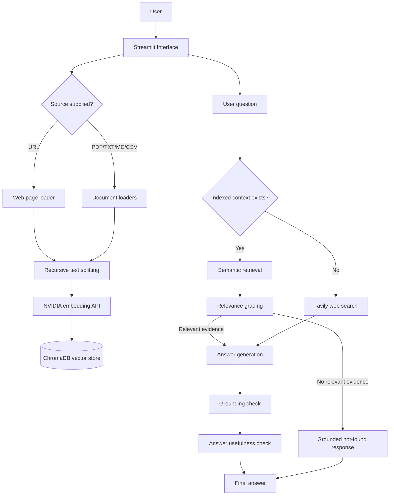

# Agentic RAG with AI Agent

## Project documentation report

**Project type:** Source-grounded conversational AI / Retrieval-Augmented Generation (RAG) system  
**Current local interface:** Streamlit  
**Primary inference model:** `nvidia/nemotron-3.5-lightning-30b-a3b`  
**Embedding model:** `nvidia/nemotron-3-embed-1b`  
**Prepared for:** Project documentation, viva preparation, and presentation development  
**Report date:** 5 October 2026

---

## 1. Executive summary

Agentic RAG with AI Agent is a question-answering application that produces answers from user-provided sources rather than relying only on a general-purpose language model. Users can add web URLs or upload documents such as PDF, TXT, Markdown, and CSV files. The system extracts text, splits it into searchable chunks, converts chunks into vector embeddings, stores them in ChromaDB, retrieves the most relevant chunks for a question, and asks an NVIDIA-hosted language model to generate an answer grounded in that retrieved context.

The project adds an agentic layer around basic RAG. The workflow decides whether a local knowledge base exists, retrieves relevant evidence, checks the relevance of retrieved text, generates an answer, and evaluates whether the answer is grounded and useful. When no sources have been added, the application uses Tavily web search as a fallback. When user sources exist but do not contain the answer, it returns a safe “not found in indexed sources” response instead of substituting an unrelated web answer.

The implementation was adapted from the NVIDIA Agentic RAG reference project for direct local execution on macOS without NVIDIA AI Workbench. The active application is a Streamlit interface in `app.py`; original Workbench/Gradio-related components remain as legacy code.

---

## 2. Problem statement

Large Language Models are capable of fluent natural-language responses, but they can generate inaccurate information, lack awareness of private or recent documents, and provide answers without a transparent source basis. A user needs a simple interface to ask questions about their own documents or selected webpages while reducing unsupported responses.

The problem addressed by this project is:

> How can a conversational AI system answer questions using user-supplied documents and webpages, retrieve relevant evidence before generation, and avoid answering from unrelated information when the requested fact is absent from the available source context?

---

## 3. Objectives

### Main objective

Develop a web-based Agentic RAG assistant that gives context-aware answers from uploaded documents and URLs, with validation steps intended to improve relevance and reduce hallucination.

### Specific objectives

1. Accept PDFs, text files, Markdown files, CSV files, and URLs as knowledge sources.
2. Extract, split, embed, and index source text in a vector database.
3. Retrieve semantically relevant text for a user question.
4. Generate a concise answer using retrieved context and an NVIDIA-hosted LLM.
5. Grade retrieved documents for relevance before generation.
6. Check whether a generated answer is grounded in its context and addresses the question.
7. Use Tavily web search only when no indexed local context exists.
8. Prevent unrelated web fallback when an indexed document does not answer the question.
9. Provide an accessible Streamlit user interface with source-status feedback.

---

## 4. Motivation and significance

Standard chatbots are useful for broad questions but are not sufficient for personal, organisational, academic, or technical knowledge bases. Their responses may be plausible but unsupported. This project is motivated by the need for answers that are tied to known input sources.

Typical use cases include:

- Resume and portfolio question answering
- Academic notes and research-paper exploration
- University course or policy information retrieval
- Technical documentation support
- Organisation-specific knowledge assistants
- Curated news and webpage briefing

The system demonstrates how RAG and agentic validation can make LLM-based applications more useful in settings where reliability and source relevance matter.

---

## 5. System architecture



### Design principle

The vector store has priority once the user has provided and indexed sources. Therefore, a document-related question is answered from those sources, or the application explicitly reports that the answer is not present. This is important because it prevents a general web answer from being mistaken for a fact found in the uploaded document.

---

## 6. End-to-end workflow

### A. Knowledge-base creation

1. The user uploads a file or provides one or more URLs.
2. URLs are fetched with `WebBaseLoader`; files are loaded with `PyPDFLoader`, `TextLoader`, or `CSVLoader`.
3. The application divides loaded content with `RecursiveCharacterTextSplitter`.
4. Each chunk is embedded by NVIDIA’s `nvidia/nemotron-3-embed-1b` endpoint.
5. Chunks and embeddings are persisted in ChromaDB under a session-specific collection name.

### B. Question-answering workflow

1. The user enters a question in Streamlit.
2. The LangGraph workflow checks whether the current session has indexed context.
3. If context exists, the workflow retrieves semantically similar chunks from ChromaDB.
4. A relevance grader accepts or discards each chunk.
5. If relevant chunks remain, the generator creates an answer from the retrieved content.
6. The system checks whether the answer is grounded in the retrieved evidence and whether it answers the question.
7. If no indexed context exists, the workflow performs Tavily web search and generates an answer from the search content.
8. If indexed context exists but does not support the question, the workflow returns a source-grounded not-found response.

---

## 7. Technical implementation

### Application layer

| Component | Implementation | Responsibility |
|---|---|---|
| User interface | Streamlit | Chat interface, source upload, URL entry, source status, session state |
| Agent orchestration | LangGraph | Defines routing, retrieval, generation, grading, and workflow transitions |
| LLM integration | LangChain + `ChatOpenAI` | Uses NVIDIA’s OpenAI-compatible API endpoint |
| Document processing | LangChain community loaders | Reads PDF, TXT, Markdown, CSV, and webpage content |
| Vector database | ChromaDB / `langchain-chroma` | Persists chunks and executes semantic similarity retrieval |
| Embeddings | NVIDIA API + HTTPX | Sends passage/query embeddings to NVIDIA’s embedding endpoint |
| Search | Tavily Search API | Provides web-search context when no indexed sources exist |
| Configuration | `.env` + `python-dotenv` | Keeps API keys and runtime options outside source code |

### Models and APIs

| Purpose | Service/model | Notes |
|---|---|---|
| Chat, generation, and grading | `nvidia/nemotron-3.5-lightning-30b-a3b` | Hosted through `https://integrate.api.nvidia.com/v1` |
| Embeddings | `nvidia/nemotron-3-embed-1b` | Uses `passage` for documents and `query` for questions |
| Web search | Tavily | Default top results: 3 |

### Key source files

| File | Role |
|---|---|
| `app.py` | Active Streamlit application and UI state management |
| `code/chatui/utils/compile.py` | Builds the LangGraph workflow |
| `code/chatui/utils/graph.py` | Agent nodes: retrieval, web search, generation, relevance and answer checks |
| `code/chatui/utils/database.py` | Source loading, chunking, embeddings, ChromaDB operations |
| `code/chatui/prompts/prompts_nemotron.py` | Prompts for generation and grading |
| `.env.example` | Safe template for required environment variables |
| `requirements.txt` | Dependencies for the supported Streamlit application |
| `requirements-legacy-workbench.txt` | Optional dependencies for the original Workbench/Gradio route |

---

## 8. Core algorithms and concepts

### 8.1 Retrieval-Augmented Generation (RAG)

RAG combines information retrieval with language generation. Instead of answering solely from model parameters, the assistant retrieves relevant source passages and supplies them as context to the LLM. In this project, that context is made from uploaded files, indexed URLs, or web search results.

### 8.2 Text chunking

Long documents are split into smaller chunks using recursive character-based splitting. The configured default chunk size is 250 tokens with no overlap. Chunking keeps embedding requests manageable and makes retrieved context more focused.

### 8.3 Dense vector embeddings and semantic search

Each text chunk is represented as a numeric embedding vector. User questions are embedded in the same vector space. ChromaDB retrieves chunks that are semantically close to the question, not merely chunks containing exact keyword matches.

### 8.4 Agent routing

The graph uses a simple source-aware routing policy:

- If session context exists: retrieve from ChromaDB first.
- If no session context exists: search the web using Tavily.

This policy intentionally protects user-provided context from being overridden by unrelated search results.

### 8.5 Relevance grading

Retrieved chunks are passed to an LLM grader that determines whether each chunk is relevant to the question. Only chunks accepted by the grader go to answer generation.

### 8.6 Grounding and answer usefulness checks

After generation, two checks are performed:

- **Grounding check:** Is the response supported by retrieved evidence?
- **Usefulness check:** Does the response answer the user’s question?

The implementation accepts either JSON-like or plain `yes`/`no` grader responses. This makes the workflow robust to minor format variation from hosted models.

### 8.7 Safe failure behavior

If local sources are not relevant, the system does not perform unrelated web fallback. It returns:

> “I couldn't find that information in the indexed sources. Try a more specific question or add another source.”

This is a deliberate precision and safety feature.

---

## 9. Input and output specification

### Inputs

| Input | Supported form | Processing |
|---|---|---|
| Web source | One URL per line | Page content is downloaded, parsed, split, embedded, and indexed |
| Document source | PDF, TXT, MD, CSV | File text is extracted, split, embedded, and indexed |
| User question | Natural-language text | Used for retrieval and answer generation |
| NVIDIA API key | `NVIDIA_API_KEY` | Required for embeddings and chat/model calls |
| Tavily API key | `TAVILY_API_KEY` | Required for web-search fallback |

### Outputs

- Answer generated from retrieved evidence
- Clear not-found response if user sources do not contain the answer
- Error messages for invalid source retrieval, incorrect API configuration, search failure, or recursion limits
- Sidebar status showing whether services are ready, which model is in use, and whether context exists

---

## 10. User interface and user experience

The active UI is a Streamlit application with the following elements:

- A research-oriented landing area and read-only model status
- Service readiness indicator
- Knowledge-base status indicator: **Web search fallback** or **Context ready**
- Sidebar for URL inputs and document uploads
- Automatic indexing of newly selected files
- List of indexed source names
- Session-specific context clearing
- Chat-style question-and-answer display

The model name is displayed but intentionally not user-editable. This makes the runtime configuration predictable and avoids accidental use of retired or unsupported model IDs.

---

## 11. Environment setup and execution

### Required software

- macOS, Linux, or Windows with Python/Conda available
- Python 3.11 was used for the verified local environment
- Internet connection
- NVIDIA Build API key with hosted inference access
- Tavily API key

### Configuration

Create `.env` from `.env.example`:

```env
NVIDIA_API_KEY=your_nvidia_build_api_key
TAVILY_API_KEY=your_tavily_api_key
NVIDIA_MODEL_ID=nvidia/nemotron-3.5-lightning-30b-a3b
RAG_DATA_DIR=./data
TAVILY_K=3
RECURSION_LIMIT=10
```

### Local launch commands

```bash
cd ~/Documents/Agentic-RAG
conda activate agentic-rag
streamlit run app.py
```

### Important credential note

The NVIDIA hosted inference API uses an NVIDIA Build API key, typically beginning with `nvapi-`. It is different from an NGC personal key used for container registry or catalog access. Keys must not be committed to Git or shared publicly.

---

## 12. Testing and validation performed

The following checks were completed on the current project implementation:

| Test | Result |
|---|---|
| Python compilation of application and workflow modules | Passed |
| Dependency consistency check | Passed |
| Streamlit application startup | Passed |
| NVIDIA hosted chat request | Passed after enabling valid Build inference access |
| NVIDIA embedding request | Passed with `nvidia/nemotron-3-embed-1b` |
| ChromaDB indexing and semantic retrieval | Passed |
| Tavily web-search request | Passed |
| Full web-search agent workflow | Passed |
| Full document retrieval, relevance grading, generation, grounding and answer grading workflow | Passed |
| Relevant document question | Passed |
| Unrelated question with indexed document | Returns source-grounded not-found response |
| Plain `yes` / `no` grader-output handling | Passed |

During implementation, retired NVIDIA model IDs and strict JSON parser assumptions were identified and corrected. The application now supports plain yes/no grader output as well as structured responses.

---

## 13. Strengths

1. Uses private, session-specific vector collections rather than one shared default collection.
2. Supports both files and webpages as knowledge sources.
3. Uses semantic embeddings rather than exact keyword-only search.
4. Includes relevance, grounding, and usefulness evaluation stages.
5. Uses safe behavior when indexed sources do not answer the question.
6. Separates secrets from source code using `.env`.
7. Runs locally without requiring NVIDIA AI Workbench.
8. Has a simple UI that exposes source and service status to the user.

---

## 14. Current limitations

1. The system does not currently display citation links or source chunk references alongside each answer.
2. Input quality depends on document text extraction; scanned/image-only PDFs may require OCR support.
3. URL indexing depends on whether a webpage permits direct loading and contains readable text.
4. The current app does not include persistent user accounts, authentication, or role-based access control.
5. Source files stored locally under the session upload folder require a separate retention/cleanup policy for production use.
6. Evaluation uses LLM graders, so results may still vary with model behavior and prompt design.
7. Agent retry behavior is bounded by the configured LangGraph recursion limit.
8. The original legacy Workbench/Gradio project files are present, but the verified and supported local entry point is Streamlit `app.py`.

---

## 15. Future enhancements

- Add source citations, page numbers, and clickable evidence snippets to every answer.
- Add OCR for scanned PDF files and image-based documents.
- Add support for DOCX, XLSX, PowerPoint, and additional content types.
- Add metadata filtering by source, date, topic, or document owner.
- Add user authentication and per-user storage for production deployment.
- Add document deletion controls and automatic upload-retention cleanup.
- Add evaluation datasets with measurable retrieval precision, answer faithfulness, latency, and user-satisfaction metrics.
- Add conversational memory with user controls.
- Add optional reranking for stronger retrieval quality.
- Add a deployment configuration for Streamlit Community Cloud, Docker, or a managed cloud platform.

---

## 16. Conclusion

Agentic RAG with AI Agent demonstrates a practical source-grounded question-answering system. Its central contribution is not merely calling an LLM; it combines document ingestion, vector retrieval, agent routing, response generation, and multiple answer checks into one application. By preferring user-indexed sources and refusing to replace unsupported document answers with unrelated web results, the project prioritizes answer traceability and relevance. The completed Streamlit implementation provides a solid foundation for academic documentation, demonstrations, and future enhancement into a production-grade knowledge assistant.

---

## 17. Suggested documentation chapter mapping

| Academic document chapter | Use material from this report |
|---|---|
| Introduction | Sections 1–4 |
| Literature Review | Explain RAG, vector search, embeddings, agent workflows; add external academic citations |
| Problem Statement and Objectives | Sections 2–3 |
| Methodology | Sections 5–8 |
| System Design / Architecture | Sections 5–7 |
| Implementation | Sections 7, 9–11 |
| Results and Testing | Section 12 |
| Limitations and Future Scope | Sections 14–15 |
| Conclusion | Section 16 |

## 18. Suggested references to add in the formal report

Add citations from primary/official sources for:

1. Retrieval-Augmented Generation research literature.
2. LangChain and LangGraph documentation.
3. ChromaDB documentation.
4. NVIDIA NIM / NVIDIA API documentation.
5. Tavily API documentation.
6. Streamlit documentation.
7. The original NVIDIA Agentic RAG reference repository and its Apache 2.0 license.

Do not claim benchmark accuracy, speed, or percentage improvements unless you first run a formal evaluation with a fixed dataset and record reproducible metrics.
